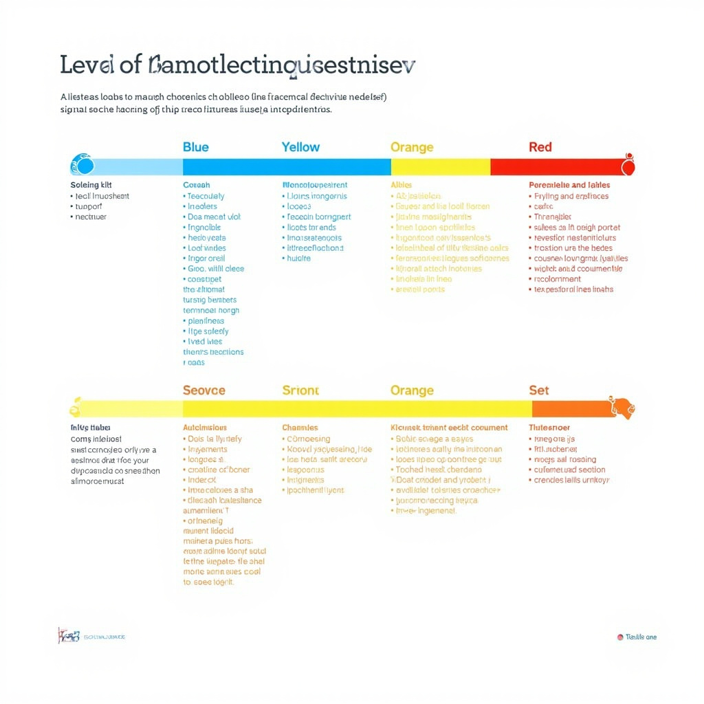
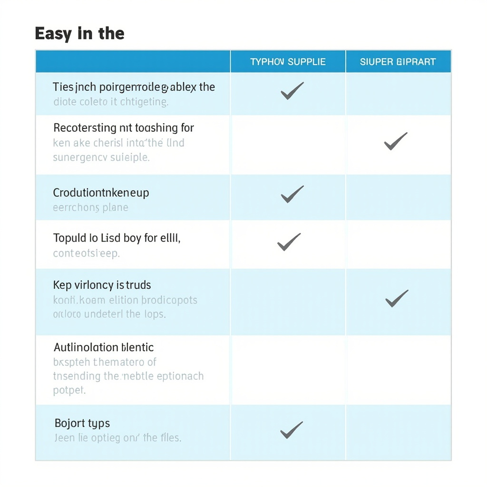
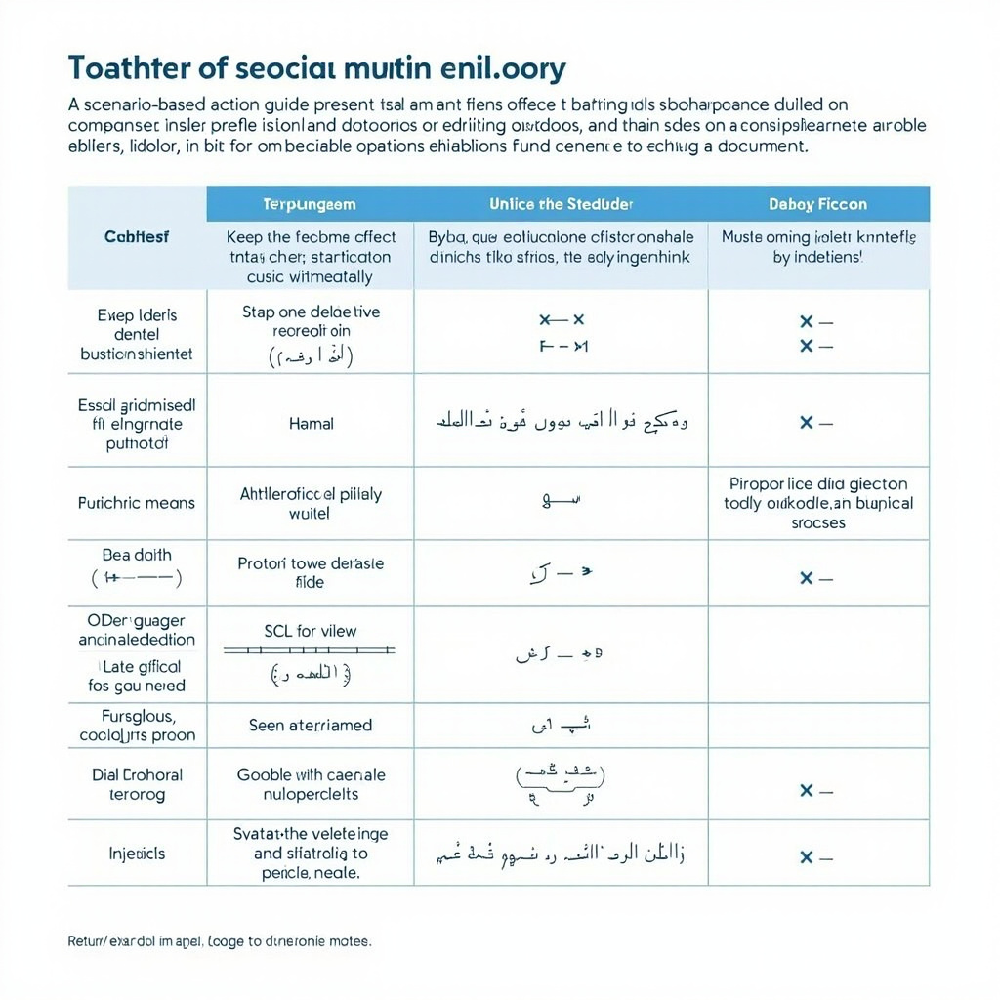

# 公众台风预防指南

## 了解台风风险与预警信息

### 台风常见危害

台风的影响很少只表现为“风大”。强风会吹落广告牌、树枝和屋顶构件，损坏门窗，导致高空坠物和停电；暴雨可能在短时间内引发城市内涝、道路积水、山洪和滑坡；风暴潮则会推高沿海水位，造成海水倒灌、堤岸受损和低洼地区受淹。台风过后，积水、倒伏电线、污染水源和受损建筑还可能带来触电、溺水、疫病及交通事故等次生风险。对普通家庭而言，这些危害可能表现为出行中断、供水中断、通信不稳、房屋进水、车辆受损，甚至被迫转移。因此，风雨来临前就应把“可能受影响”具体到住所、出行和家人照护上，而不是等警报升级后再临时判断。

### 预警信号与信息渠道

我国台风预警信号通常按蓝、黄、橙、红四级发布，严重程度依次升高：蓝色表示需要开始关注和准备，黄色意味着影响增强、应减少不必要的户外活动，橙色表示风险较高、应停止或调整户外安排并做好转移准备，红色表示影响严重、应避免外出并服从当地应急安排。不同地区可能结合风雨影响调整防御指引，因此看到信号后还要阅读本地发布的具体要求。可结合[台风预警信号与行动对照表](#block-IMAGE-1)快速识别等级、主要风险和对应行动。获取信息时，应优先查看气象部门发布的台风路径、风雨预报和预警，关注应急管理部门、当地政府、社区通知以及广播、电视和本地媒体；不要只依赖聊天群截图或未经核实的短视频，并尽量在停电前准备好收音机、充电宝和备用联系方式。

### 家庭风险快速评估

家庭可先用十分钟做一次快速评估：看居住位置是否靠近海岸、河道、山坡、低洼地带或易涝路段；看房屋是否老旧、门窗是否牢固、屋顶和阳台是否有易坠落物；看家中是否有老人、儿童、孕产妇、残障成员、慢性病患者或需要特别照护的宠物。若住在风暴潮影响区、地质灾害隐患点、危旧房或临时建筑内，应把提前转移作为优先选项；若住所相对安全，也要明确停电、停水、进水时的应对办法和家庭集合点。评估结果应转化为具体行动：谁负责联系、谁负责拿药、重要证件放哪里、车辆停何处、附近避难场所在哪里。风险认清得越早，后续准备和避险就越从容。

## 台风来临前的家庭准备

### 应急物资储备
备足饮用水、耐储食品、常用药品、手电和通信设备，定期检查数量与有效期；可对照[家庭防台准备清单](#block-IMAGE-2)逐项落实。

### 房屋与户外设施加固
检查门窗锁扣，收回阳台花盆、晾衣架等易坠物，固定空调外机、遮阳棚及自设广告牌，清理排水口。

### 家庭联络与撤离计划
约定紧急联络方式、集合地点和撤离路线，明确老人、儿童及行动不便成员的照护人，确保接到通知后迅速撤离。

## 台风影响期间的安全避险

### 居家避险要点
服从预警少外出；关窗、远离玻璃，慎用电火防进水。

### 外出与行车风险规避
避沿海低洼山区；驾车减速、慎涉水、勿停低洼。

### 特殊场景应急处置
停电进水先断电；被困高层待援，见[场景对照](#block-IMAGE-3)。

## 台风过后与恢复

### 返家与设施检查
返家先按[返家与恢复检查表](#block-IMAGE-4)核对建筑结构、燃气电气和积水隐患，确认安全后再恢复使用相关设施。

### 饮食卫生与疾病预防
接触洪水后及时清洁消毒，保障饮水与食品安全，并做好防蚊防病。

### 社区互助与心理调适
多关注邻里中的脆弱人群，通过沟通和规律作息缓解灾后紧张情绪。
